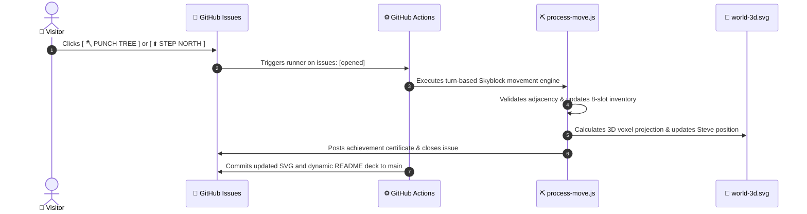

# 🏝️ Minecraft Skyblock Multiplayer Realm

<p align="center">
  
</p>

<div align="center">

## 🎮 Contextual Command Deck: Make Your Move!
*Steve is currently at **Tile [1, 2]**. Click any valid button below to submit the next multiplayer move via GitHub Issues!*

### 🚶 Cardinal Movement (Step to Adjacent Tile)
<p>
  [](https://github.com/mo-farooq/skyblock/issues/new?title=Move%3A+Step+North&body=Moving+Steve+North+on+the+Skyblock+Island)
  &nbsp;
  [](https://github.com/mo-farooq/skyblock/issues/new?title=Move%3A+Step+South&body=Moving+Steve+South+on+the+Skyblock+Island)
  &nbsp;
  [](https://github.com/mo-farooq/skyblock/issues/new?title=Move%3A+Step+East&body=Moving+Steve+East+on+the+Skyblock+Island)
  &nbsp;
  [](https://github.com/mo-farooq/skyblock/issues/new?title=Move%3A+Step+West&body=Moving+Steve+West+on+the+Skyblock+Island)
</p>

### 🛠️ Contextual Adjacency Actions (Active for Current Tile)
<p>
  [](https://github.com/mo-farooq/skyblock/issues/new?title=Action%3A+Punch+Oak+Tree&body=Steve+is+beside+the+Tree%21+Harvesting+wood+logs.)
  &nbsp;
  [](https://github.com/mo-farooq/skyblock/issues/new?title=Action%3A+Mine+Cobblestone&body=Mining+fresh+cobblestone+from+the+lava%2Fwater+generator%21)
  &nbsp;
  [](https://github.com/mo-farooq/skyblock/issues/new?title=Action%3A+Bridge+Planks&body=Placing+a+wooden+plank+bridge+block+into+the+void+towards+the+Ender+Dragon%21)
  &nbsp;
  [](https://github.com/mo-farooq/skyblock/issues/new?title=Action%3A+Place+Furnace&body=Deploying+a+stone+furnace+onto+the+island%21)
  &nbsp;
  [](https://github.com/mo-farooq/skyblock/stargazers)
</p>

---

### 🎒 Steve's 8-Slot Hotbar Pack
| Slot 1 | Slot 2 | Slot 3 | Slot 4 | Slot 5 | Slot 6 | Slot 7 | Slot 8 |
| :---: | :---: | :---: | :---: | :---: | :---: | :---: | :---: |
| **🪵 Oak Log**<br>(`x5`) | **🪵 Oak Planks**<br>(`x16`) | **🪨 Cobblestone**<br>(`x12`) | **🪚 Crafting Table**<br>(`x1`) | **♨️ Furnace**<br>(`x1`) | **🕯️ Torch**<br>(`x4`) | **🍞 Bread**<br>(`x5`) | **💎 Diamond**<br>(`x2`) |

</div>

> [!TIP]
> ⭐ **Stargazer VIP Perk**: Starring this repository grants your next bridge placement **Luminous Cyan Diamond Block** status with special particle gleams and +50 damage to the Ender Dragon!

---

## ⚡ Architecture & Turn-Based Event Loop



---

## 🛠️ Engine Highlights

- **Pure 3D Voxel SVG**: Authentic 2:1 isometric L-shaped Skyblock island with solitary oak tree, starter chest, and cobblestone generator.
- **Dynamic Contextual Buttons**: README buttons update in real-time depending on Steve's current coordinates.
- **8-Slot Inventory Management**: Strict item tracking for oak logs, planks, cobblestone, furnaces, and rare diamond gems.
- **Multiplayer Community Boss Raid**: Ender Dragon boss meter ticks down with every void bridge built toward the End dimension!

---

## 🚀 Local Development

```bash
# Clone the repository
git clone https://github.com/mo-farooq/skyblock.git
cd skyblock

# Re-render world-3d.svg
npm run render

# Test a move simulation
npm run test-build
```
