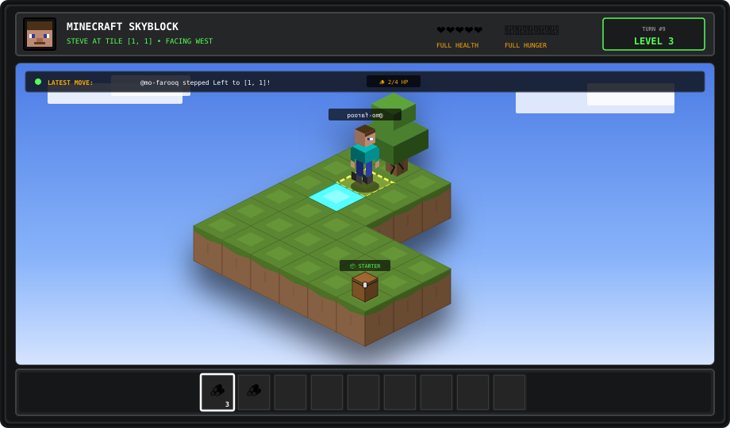

# 🏝️ Minecraft Skyblock Survival

<p align="center">
  
</p>

<div align="center">

## 🎮 Dynamic Gamepad Controller: Make Your Move!
*Steve is at **Tile [1, 1]**. The camera is locked to Steve, and buttons update in real-time!*

> 💡 **How to Play:** Click any button below &rarr; click the green **"Create"** button on GitHub &rarr; Steve moves & the island updates in ~15s!

<table>
  <tr>
    <th align="center" colspan="3">🕹️ D-PAD MOVEMENT</th>
    <th width="40"></th>
    <th align="center">⚡ AVAILABLE ACTIONS</th>
  </tr>
  <tr>
    <td></td>
    <td align="center">
      <a href="https://github.com/mo-farooq/skyblock/issues/new?template=skyblock-move.md&title=Move%3A%20Step%20Forward"></a>
    </td>
    <td></td>
    <td></td>
    <td align="center" rowspan="3">
      <a href="https://github.com/mo-farooq/skyblock/issues/new?template=skyblock-move.md&title=Action%3A%20Punch%20Oak%20Tree"></a><br><br><a href="https://github.com/mo-farooq/skyblock/stargazers"></a>
    </td>
  </tr>
  <tr>
    <td align="center">
      <a href="https://github.com/mo-farooq/skyblock/issues/new?template=skyblock-move.md&title=Move%3A%20Step%20Left"></a>
    </td>
    <td align="center">
      
    </td>
    <td align="center">
      <a href="https://github.com/mo-farooq/skyblock/issues/new?template=skyblock-move.md&title=Move%3A%20Step%20Right"></a>
    </td>
    <td></td>
  </tr>
  <tr>
    <td></td>
    <td align="center">
      <a href="https://github.com/mo-farooq/skyblock/issues/new?template=skyblock-move.md&title=Move%3A%20Step%20Backward"></a>
    </td>
    <td></td>
    <td></td>
  </tr>
</table>

### 🔨 Available Crafting Recipes (Based on Current Inventory)
<p>
  <a href="https://github.com/mo-farooq/skyblock/issues/new?template=skyblock-move.md&title=Action%3A%20Craft%204%20Planks"></a>
</p>

</div>

---

## ⚡ How It Works

- **Authentic Minecraft SkyBlock**: Faithfully modeled on Noobcrew's classic 2011 27-block L-island layout with 4 vertical dirt layers and a bedrock cornerstone.
- **Camera-Anchored Viewport**: Steve is locked permanently at the center of the screen; the floating platform translates smoothly beneath him as he navigates across the void!
- **Dynamic Crafting Bench**: Recipe buttons only appear when Steve holds the exact ingredients in his hotbar pack.
- **Empty-Handed Start**: Steve spawns with 0 inventory items. Gather oak logs to craft planks, sticks, and tools!

---

## 🚀 Local Development

```bash
# Clone repository
git clone https://github.com/mo-farooq/skyblock.git
cd skyblock

# Re-render world-3d.svg
npm run render

# Test a mock turn
npm run test-build
```
