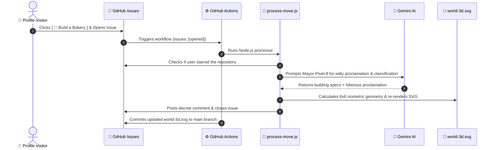

# 🪐 Antigravity Community World 3D

<p align="center">
  
</p>

<p align="center">
  <strong>An interactive 3D Isometric Community World rendered entirely in SVG, powered by Google Antigravity, GitHub Actions, and Gemini AI.</strong><br>
  <em>Auto-adapts between Light Mode and Dark Mode with dynamic isometric lighting and starfields.</em>
</p>

---

## 🏗️ Interactive Citizen Hub: Claim Your Plot!

Pick a building type below to open a pre-filled GitHub Issue. The autonomous **AI Mayor (Pixel-8)** will analyze your request with Gemini, lay the cornerstone on the 6x6 isometric grid, and update the live profile world within seconds!

<div align="center">

| Building Permit | Action Link |
| :--- | :--- |
| 🥐 **Artisan Bakery** | [**[ 🥐 Build a Bakery ]**](https://github.com/Farooq/Farooq/issues/new?title=Build%3A+%F0%9F%A5%90+Artisan+Bakery&body=%23%23+Citizen+Construction+Permit%0A%0AHey+Mayor+Pixel-8%2C+I+would+love+to+open+a+fresh+croissant+bakery+for+the+neighborhood%21) |
| ☕ **Neon Coffee Lab** | [**[ ☕ Open a Coffee Lab ]**](https://github.com/Farooq/Farooq/issues/new?title=Build%3A+%E2%98%95+Neon+Coffee+Lab&body=%23%23+Citizen+Construction+Permit%0A%0APlease+approve+a+24%2F7+cyber-espresso+lab+to+keep+developers+caffeinated%21) |
| 🎮 **Synthwave Arcade** | [**[ 🎮 Open an 80s Arcade ]**](https://github.com/Farooq/Farooq/issues/new?title=Build%3A+%F0%9F%8E%AE+80s+Synthwave+Arcade&body=%23%23+Citizen+Construction+Permit%0A%0ARequesting+a+permit+for+a+retro+arcade+cabinet+palace+with+neon+marquees%21) |
| 🚀 **Apollo-X Spaceport** | [**[ 🚀 Build a Spaceport ]**](https://github.com/Farooq/Farooq/issues/new?title=Build%3A+%F0%9F%9A%80+Apollo-X+Spaceport&body=%23%23+Citizen+Construction+Permit%0A%0ATime+to+reach+the+stars.+Requesting+a+launchpad+for+orbital+antigravity+shuttles%21) |
| 🌲 **Emerald Zen Park** | [**[ 🌲 Plant a Zen Park ]**](https://github.com/Farooq/Farooq/issues/new?title=Build%3A+%F0%9F%8C%B2+Emerald+Zen+Park&body=%23%23+Citizen+Construction+Permit%0A%0AWe+need+more+greenery+in+Antigravity+Town.+Planting+a+3D+isometric+pine+sanctuary%21) |
| 🤖 **AI Neural Datacenter** | [**[ 🤖 Spin up a Datacenter ]**](https://github.com/Farooq/Farooq/issues/new?title=Build%3A+%F0%9F%A4%96+AI+Neural+Datacenter&body=%23%23+Citizen+Construction+Permit%0A%0AAllocating+a+cluster+of+Gemini-powered+server+racks+with+liquid+nitrogen+cooling%21) |
| 🔭 **Deep Horizon Observatory** | [**[ 🔭 Build an Observatory ]**](https://github.com/Farooq/Farooq/issues/new?title=Build%3A+%F0%9F%94%AD+Deep+Horizon+Observatory&body=%23%23+Citizen+Construction+Permit%0A%0AA+high-powered+telescope+dome+to+study+distant+galaxies+from+our+github+skyline%21) |
| 🏢 **Skyline Tower** | [**[ 🏢 Construct a Tower ]**](https://github.com/Farooq/Farooq/issues/new?title=Build%3A+%F0%9F%8F%A2+Skyline+Innovation+Tower&body=%23%23+Citizen+Construction+Permit%0A%0AErecting+a+modern+high-rise+with+a+rooftop+helipad+for+future+innovators%21) |

</div>

> [!TIP]
> ⭐ **Star-Magnet Perk**: Starring this repository before submitting your issue grants your plot **VIP Golden Foundation** status and special recognition in the AI Mayor's decree!

---

## ⚡ How It Works



---

## 🚀 Repository Structure

```
.
├── .github/
│   └── workflows/
│       └── update-world.yml    # Triggers on issues: [opened] & auto-commits
├── data/
│   └── world-state.json        # 6x6 grid state, building levels & Mayor logs
├── scripts/
│   ├── process-move.js         # Core bot: GitHub API + Gemini + plot assignment
│   └── render-svg.js           # 3D isometric SVG rendering engine
├── world-3d.svg                # Auto-switching Day/Night 3D SVG render
├── package.json
└── README.md
```

---

## 🛠️ Deployment Checklist

If you are setting this up on your own GitHub profile repository:

1. **Set your Gemini API Key**:
   - Go to **Settings > Secrets and variables > Actions > New repository secret**.
   - Name: `GEMINI_API_KEY`.
   - Value: Your Google AI Studio key (`AIzaSy...`).

2. **Enable Workflow Write Permissions**:
   - Go to **Settings > Actions > General**.
   - Under **Workflow permissions**, select **Read and write permissions**.
   - Check **Allow GitHub Actions to create and approve pull requests**.
   - Click **Save**.

3. **Update URLs in README.md**:
   - Replace `Farooq/Farooq` in the issue links above with your own `username/repository`.

4. **Test Locally**:
   ```bash
   # Run a mock simulation of a user opening an issue
   npm run test-build

   # Re-render the SVG from data/world-state.json
   npm run render
   ```

---

<p align="center">
  Crafted with ❤️ in <strong>Google Antigravity</strong> • Powered by <strong>Gemini</strong> & <strong>GitHub Actions</strong>
</p>
