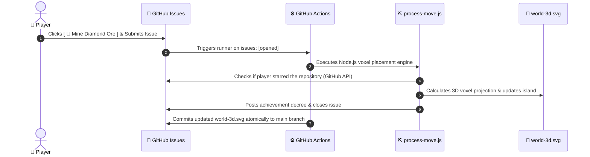

# ⛏️ Minecraft 3D Voxel Realm

<p align="center">
  
</p>

<p align="center">
  <strong>An authentic Minecraft 3D Voxel World rendered purely in SVG, powered by Node.js and event-driven GitHub Actions webhooks.</strong><br>
  <em>Engineered with pixel-perfect isometric voxel projection, live Steve & Alex rigs, Ender Dragon raid boss bar, and real-time community block crafting.</em>
</p>

---

## 🎮 Interactive Crafting Bench: Place Your Block!

Click any item below to open a pre-filled GitHub Issue. The autonomous Minecraft game engine will process your craft, place your voxel block on the 6x6 island canvas, and update the live realm within seconds!

<div align="center">

| Minecraft Item | Recipe Action |
| :--- | :--- |
| 💎 **Diamond Block** | [**[ 💎 Mine Diamond Ore ]**](https://github.com/mo-farooq/mo-farooq/issues/new?title=Craft%3A+%F0%9F%92%8E+Diamond+Block&body=%23%23+Minecraft+Crafting+Request%0A%0ASteve%2C+I+struck+diamonds%21+Placing+a+rare+Diamond+Block+on+the+island%21) |
| 🏰 **Cobblestone Fort** | [**[ 🏰 Build Cobblestone Fort ]**](https://github.com/mo-farooq/mo-farooq/issues/new?title=Craft%3A+%F0%9F%8F%B0+Cobblestone+Fort&body=%23%23+Minecraft+Crafting+Request%0A%0AConstructing+a+fortified+cobblestone+outpost+to+defend+against+night+raids%21) |
| 🍞 **Village Bakery** | [**[ 🍞 Bake Bread & Crops ]**](https://github.com/mo-farooq/mo-farooq/issues/new?title=Craft%3A+%F0%9F%A5%90+Village+Bakery&body=%23%23+Minecraft+Crafting+Request%0A%0ACrafting+a+village+bakery+with+wheat+crops+to+keep+hunger+bars+full%21) |
| ☕ **Nether Tavern** | [**[ ☕ Brew Potion & Cafe ]**](https://github.com/mo-farooq/mo-farooq/issues/new?title=Craft%3A+%E2%98%95+Nether+Tavern&body=%23%23+Minecraft+Crafting+Request%0A%0ASetting+up+a+brewing+stand+and+cozy+coffee+tavern+for+weary+miners%21) |
| 🌲 **Oak Canopy Grove** | [**[ 🌲 Plant Oak Tree ]**](https://github.com/mo-farooq/mo-farooq/issues/new?title=Craft%3A+%F0%9F%8C%B2+Oak+Grove&body=%23%23+Minecraft+Crafting+Request%0A%0APlanting+an+oak+sapling+to+grow+cubic+foliage+and+harvest+wood+logs%21) |
| 💥 **Redstone Mechanism** | [**[ 💥 Place Redstone & TNT ]**](https://github.com/mo-farooq/mo-farooq/issues/new?title=Craft%3A+%F0%9F%92%A5+Redstone+Machine&body=%23%23+Minecraft+Crafting+Request%0A%0AWiring+a+redstone+circuit+with+repeaters+and+pressure+plates%21) |
| 🏹 **Pillager Watchtower** | [**[ 🏹 Erect Watchtower ]**](https://github.com/mo-farooq/mo-farooq/issues/new?title=Craft%3A+%F0%9F%8F%B9+Pillager+Watchtower&body=%23%23+Minecraft+Crafting+Request%0A%0AErecting+a+tall+wood+and+cobblestone+lookout+to+spot+the+Ender+Dragon%21) |

</div>

> [!TIP]
> ⭐ **Stargazer Perk**: Starring this repository unlocks **VIP Diamond & Netherite** status, giving your block rare cyan mineral gleams and special mention in Steve's realm decree!

---

## ⚡ Game Loop & Technical Architecture



---

## 🛠️ Technical Highlights

- **Pure Voxel SVG Engine**: Renders 2:1 isometric Minecraft dirt, grass fringe, and mineral blocks purely through polygon geometry with zero raster dependencies.
- **Steve & Alex Skeletal Keyframes**: Continuous 60 FPS CSS animations featuring idle breathing, pickaxe swinging, floating experience orbs (`.xp-orb`), and cascading water blocks.
- **Authentic Minecraft GUI Overlay**: Ender Dragon raid meter, 10-heart health bar (`❤️❤️❤️❤️❤️`), hunger drumsticks (`🍗🍗🍗🍗🍗`), Level 42 badge, and 9-slot inventory hotbar.
- **Serverless Event-Driven State**: GitHub Actions handles turn resolution and git-syncs state atomically within 15 seconds.

---

## 🚀 Local Development

```bash
# Clone the repository
git clone https://github.com/mo-farooq/mo-farooq.git
cd mo-farooq

# Run a mock simulation of crafting a diamond block
npm run test-build

# Re-render world-3d.svg
npm run render
```
