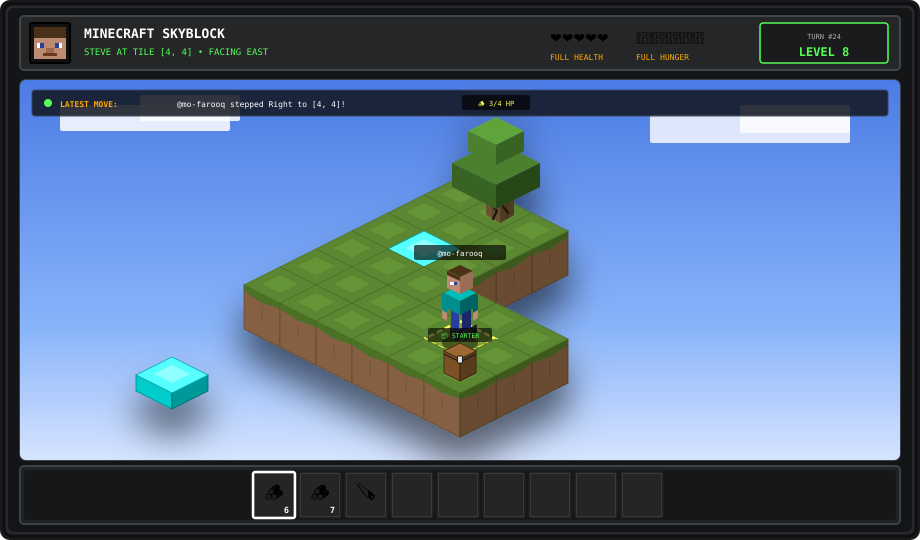

# 🏝️ Minecraft Skyblock Survival

<p align="center">
  
</p>

<div align="center">

<p align="center">
  <a href="https://github.com/mo-farooq/skyblock/actions/workflows/update-world.yml"></a> &nbsp;
  <a href="https://github.com/mo-farooq/skyblock"></a> &nbsp;
  <a href="https://github.com/mo-farooq/skyblock"></a>
</p>

## 🎮 Dynamic Gamepad Controller: Make Your Move!
*Steve is at **Tile [4, 4]** (Facing **EAST**). Explore the island, harvest the tree, and bridge into the void!*

> 💡 **How to Play:** Click any button below &rarr; click green **"Create"** &rarr; engine auto-executes turn!

<table>
  <tr>
    <th align="center" colspan="3">🕹️ D-PAD MOVEMENT</th>
    <th width="40"></th>
    <th align="center">⚡ AVAILABLE ACTIONS</th>
  </tr>
  <tr>
    <td></td>
    <td align="center">
      <a href="https://www.github.com/mo-farooq/skyblock/issues/new?title=Move%3A%20Step%20Forward&body=%23%23%23%20%F0%9F%95%B9%EF%B8%8F%20Skyblock%20Realm%20Turn%3A%20Move%3A%20Step%20Forward%0A%0A%3E%20**Click%20the%20green%20%22Create%22%20button%20below%20to%20execute%20this%20turn!**%0A%3E%20%F0%9F%8C%90%20%5BReturn%20to%20Skyblock%20Realm%5D(https%3A%2F%2Fgithub.com%2Fmo-farooq%2Fskyblock%23readme)%0A%0AMoving%20Steve%20Forward%20on%20the%20Skyblock%20Island." data-turbo="false"></a>
    </td>
    <td></td>
    <td></td>
    <td align="center" rowspan="3">
      <a href="https://www.github.com/mo-farooq/skyblock/issues/new?title=Action%3A%20Open%20Starter%20Chest&body=%23%23%23%20%F0%9F%95%B9%EF%B8%8F%20Skyblock%20Realm%20Turn%3A%20Action%3A%20Open%20Starter%20Chest%0A%0A%3E%20**Click%20the%20green%20%22Create%22%20button%20below%20to%20execute%20this%20turn!**%0A%3E%20%F0%9F%8C%90%20%5BReturn%20to%20Skyblock%20Realm%5D(https%3A%2F%2Fgithub.com%2Fmo-farooq%2Fskyblock%23readme)%0A%0AOpening%20the%20starter%20chest%20to%20loot%20lava%20and%20ice%20blocks!" data-turbo="false"></a><br><br><a href="https://www.github.com/mo-farooq/skyblock/issues/new?title=Action%3A%20Bridge%20Planks&body=%23%23%23%20%F0%9F%95%B9%EF%B8%8F%20Skyblock%20Realm%20Turn%3A%20Action%3A%20Bridge%20Planks%0A%0A%3E%20**Click%20the%20green%20%22Create%22%20button%20below%20to%20execute%20this%20turn!**%0A%3E%20%F0%9F%8C%90%20%5BReturn%20to%20Skyblock%20Realm%5D(https%3A%2F%2Fgithub.com%2Fmo-farooq%2Fskyblock%23readme)%0A%0APlacing%20an%20oak%20plank%20bridge%20block%20into%20the%20void!" data-turbo="false"></a><br><br><a href="https://github.com/mo-farooq/skyblock/stargazers"></a>
    </td>
  </tr>
  <tr>
    <td align="center">
      <a href="https://www.github.com/mo-farooq/skyblock/issues/new?title=Move%3A%20Step%20Left&body=%23%23%23%20%F0%9F%95%B9%EF%B8%8F%20Skyblock%20Realm%20Turn%3A%20Move%3A%20Step%20Left%0A%0A%3E%20**Click%20the%20green%20%22Create%22%20button%20below%20to%20execute%20this%20turn!**%0A%3E%20%F0%9F%8C%90%20%5BReturn%20to%20Skyblock%20Realm%5D(https%3A%2F%2Fgithub.com%2Fmo-farooq%2Fskyblock%23readme)%0A%0AMoving%20Steve%20Left%20on%20the%20Skyblock%20Island." data-turbo="false"></a>
    </td>
    <td align="center">
      
    </td>
    <td align="center">
      <a href="https://www.github.com/mo-farooq/skyblock/issues/new?title=Move%3A%20Step%20Right&body=%23%23%23%20%F0%9F%95%B9%EF%B8%8F%20Skyblock%20Realm%20Turn%3A%20Move%3A%20Step%20Right%0A%0A%3E%20**Click%20the%20green%20%22Create%22%20button%20below%20to%20execute%20this%20turn!**%0A%3E%20%F0%9F%8C%90%20%5BReturn%20to%20Skyblock%20Realm%5D(https%3A%2F%2Fgithub.com%2Fmo-farooq%2Fskyblock%23readme)%0A%0AMoving%20Steve%20Right%20on%20the%20Skyblock%20Island." data-turbo="false"></a>
    </td>
    <td></td>
  </tr>
  <tr>
    <td></td>
    <td align="center">
      <a href="https://www.github.com/mo-farooq/skyblock/issues/new?title=Move%3A%20Step%20Backward&body=%23%23%23%20%F0%9F%95%B9%EF%B8%8F%20Skyblock%20Realm%20Turn%3A%20Move%3A%20Step%20Backward%0A%0A%3E%20**Click%20the%20green%20%22Create%22%20button%20below%20to%20execute%20this%20turn!**%0A%3E%20%F0%9F%8C%90%20%5BReturn%20to%20Skyblock%20Realm%5D(https%3A%2F%2Fgithub.com%2Fmo-farooq%2Fskyblock%23readme)%0A%0AMoving%20Steve%20Backward%20on%20the%20Skyblock%20Island." data-turbo="false"></a>
    </td>
    <td></td>
    <td></td>
  </tr>
</table>

### 🔨 Available Crafting Recipes (Based on Current Inventory)
<p>
  <a href="https://www.github.com/mo-farooq/skyblock/issues/new?title=Action%3A%20Craft%204%20Planks&body=%23%23%23%20%F0%9F%95%B9%EF%B8%8F%20Skyblock%20Realm%20Turn%3A%20Action%3A%20Craft%204%20Planks%0A%0A%3E%20**Click%20the%20green%20%22Create%22%20button%20below%20to%20execute%20this%20turn!**%0A%3E%20%F0%9F%8C%90%20%5BReturn%20to%20Skyblock%20Realm%5D(https%3A%2F%2Fgithub.com%2Fmo-farooq%2Fskyblock%23readme)%0A%0ACrafting%204%20Oak%20Planks%20from%201%20Oak%20Log." data-turbo="false"></a> &nbsp; <a href="https://www.github.com/mo-farooq/skyblock/issues/new?title=Action%3A%20Craft%204%20Sticks&body=%23%23%23%20%F0%9F%95%B9%EF%B8%8F%20Skyblock%20Realm%20Turn%3A%20Action%3A%20Craft%204%20Sticks%0A%0A%3E%20**Click%20the%20green%20%22Create%22%20button%20below%20to%20execute%20this%20turn!**%0A%3E%20%F0%9F%8C%90%20%5BReturn%20to%20Skyblock%20Realm%5D(https%3A%2F%2Fgithub.com%2Fmo-farooq%2Fskyblock%23readme)%0A%0ACrafting%204%20Wooden%20Sticks%20from%202%20Planks." data-turbo="false"></a> &nbsp; <a href="https://www.github.com/mo-farooq/skyblock/issues/new?title=Action%3A%20Craft%20Crafting%20Table&body=%23%23%23%20%F0%9F%95%B9%EF%B8%8F%20Skyblock%20Realm%20Turn%3A%20Action%3A%20Craft%20Crafting%20Table%0A%0A%3E%20**Click%20the%20green%20%22Create%22%20button%20below%20to%20execute%20this%20turn!**%0A%3E%20%F0%9F%8C%90%20%5BReturn%20to%20Skyblock%20Realm%5D(https%3A%2F%2Fgithub.com%2Fmo-farooq%2Fskyblock%23readme)%0A%0ACrafting%20a%20Crafting%20Table%20from%204%20Planks." data-turbo="false"></a>
</p>

</div>

---

## ⚡ How It Works

- **Authentic Minecraft SkyBlock**: Faithfully modeled on Noobcrew's classic 2011 27-block L-island layout with 4 vertical dirt layers and a bedrock cornerstone.
- **Anchored Isometric World**: Faithfully modeled on classic SkyBlock; Steve physically traverses from tile to tile across the diamond island as turns execute!
- **Dynamic Crafting Bench**: Recipe buttons only appear when Steve holds the exact ingredients in his hotbar pack.
- **Empty-Handed Start**: Steve spawns with 0 inventory items. Gather oak logs to craft planks, sticks, and tools!

---

## 🚀 Local Development

```bash
# Clone repository
git clone https://github.com/mo-farooq/skyblock.git
cd skyblock

# Re-render world-3d.svg
npm run render

# Test a mock turn
npm run test-build
```
