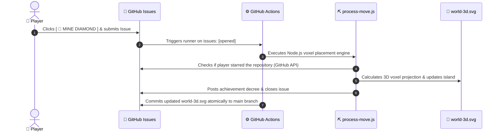

# ⛏️ Minecraft 3D Voxel Realm

<p align="center">
  
</p>

<div align="center">

## 🎮 Quick-Craft Hotbar: Click to Place on the Live Island!
*Click any item below to trigger a pre-filled GitHub Issue. GitHub Actions places your block on the 3D island in seconds!*

<p>
  <a href="https://github.com/mo-farooq/mo-farooq/issues/new?title=Craft%3A+%F0%9F%92%8E+Diamond+Block&body=%23%23+Minecraft+Crafting+Request%0A%0ASteve%2C+I+struck+diamonds%21+Placing+a+rare+Diamond+Block+on+the+island%21"></a>
  &nbsp;
  <a href="https://github.com/mo-farooq/mo-farooq/issues/new?title=Craft%3A+%F0%9F%8F%B0+Cobblestone+Fort&body=%23%23+Minecraft+Crafting+Request%0A%0AConstructing+a+fortified+cobblestone+outpost+to+defend+against+night+raids%21"></a>
  &nbsp;
  <a href="https://github.com/mo-farooq/mo-farooq/issues/new?title=Craft%3A+%F0%9F%8C%B2+Oak+Grove&body=%23%23+Minecraft+Crafting+Request%0A%0APlanting+an+oak+sapling+to+grow+cubic+foliage+and+harvest+wood+logs%21"></a>
  &nbsp;
  <a href="https://github.com/mo-farooq/mo-farooq/issues/new?title=Craft%3A+%F0%9F%92%A5+Redstone+Machine&body=%23%23+Minecraft+Crafting+Request%0A%0AWiring+a+redstone+circuit+with+repeaters+and+pressure+plates%21"></a>
</p>

<p>
  <a href="https://github.com/mo-farooq/mo-farooq/issues/new?title=Craft%3A+%F0%9F%A5%90+Village+Bakery&body=%23%23+Minecraft+Crafting+Request%0A%0ACrafting+a+village+bakery+with+wheat+crops+to+keep+hunger+bars+full%21"></a>
  &nbsp;
  <a href="https://github.com/mo-farooq/mo-farooq/issues/new?title=Craft%3A+%E2%98%95+Nether+Tavern&body=%23%23+Minecraft+Crafting+Request%0A%0ASetting+up+a+brewing+stand+and+cozy+coffee+tavern+for+weary+miners%21"></a>
  &nbsp;
  <a href="https://github.com/mo-farooq/mo-farooq/issues/new?title=Craft%3A+%F0%9F%8F%B9+Pillager+Watchtower&body=%23%23+Minecraft+Crafting+Request%0A%0AErecting+a+tall+wood+and+cobblestone+lookout+to+spot+the+Ender+Dragon%21"></a>
  &nbsp;
  <a href="https://github.com/mo-farooq/mo-farooq/stargazers"></a>
</p>

</div>

> [!TIP]
> ⭐ **Stargazer Perk**: Starring this repository unlocks **VIP Diamond & Netherite** status, giving your block rare cyan mineral gleams and special mention in Steve's realm decree!

---

## ⚡ Game Loop & Technical Architecture



---

## 🛠️ Technical Highlights

- **Pure Voxel SVG Engine**: Renders 2:1 isometric Minecraft dirt, grass fringe, and mineral blocks purely through polygon geometry with zero raster dependencies.
- **Steve & Alex Skeletal Keyframes**: Continuous 60 FPS CSS animations featuring idle breathing, pickaxe swinging, floating experience orbs (`.xp-orb`), and cascading water blocks.
- **Authentic Minecraft GUI**: Ender Dragon raid meter, 10-heart health bar (`❤️❤️❤️❤️❤️`), hunger drumsticks (`🍗🍗🍗🍗🍗`), Level 42 badge, and server announcement ticker.
- **Serverless Event-Driven State**: GitHub Actions handles turn resolution and git-syncs state atomically within 15 seconds.

---

## 🚀 Local Development

```bash
# Clone the repository
git clone https://github.com/mo-farooq/mo-farooq.git
cd mo-farooq

# Run a mock simulation of crafting a diamond block
npm run test-build

# Re-render world-3d.svg
npm run render
```
