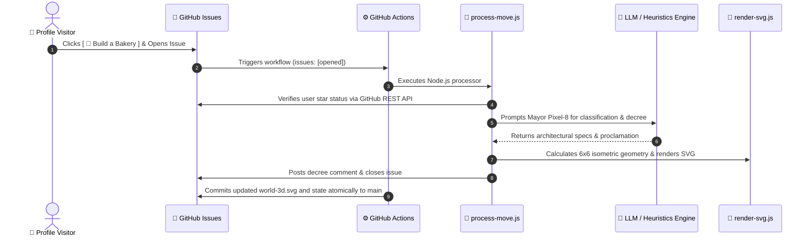

# 🪐 Isometric Community World

<p align="center">
  
</p>

<p align="center">
  <strong>An interactive 3D Isometric Community World rendered purely in SVG, orchestrated via Node.js, event-driven GitHub Actions webhooks, and Generative AI.</strong><br>
  <em>Engineered with 2:1 isometric mathematical projection, dynamic state persistence, and auto-switching Day/Night CSS themes.</em>
</p>

---

## 🏗️ Interactive Citizen Hub: Claim Your Plot!

Pick a building type below to open a pre-filled GitHub Issue. The autonomous **AI Mayor (Pixel-8)** will analyze your request, lay your cornerstone on the 6x6 isometric grid, and update the live profile skyline within seconds!

<div align="center">

| Building Permit | Action Link |
| :--- | :--- |
| 🥐 **Artisan Bakery** | [**[ 🥐 Build a Bakery ]**](https://github.com/mo-farooq/mo-farooq/issues/new?title=Build%3A+%F0%9F%A5%90+Artisan+Bakery&body=%23%23+Citizen+Construction+Permit%0A%0AHey+Mayor+Pixel-8%2C+I+would+love+to+open+a+fresh+croissant+bakery+for+the+neighborhood%21) |
| ☕ **Neon Coffee Lab** | [**[ ☕ Open a Coffee Lab ]**](https://github.com/mo-farooq/mo-farooq/issues/new?title=Build%3A+%E2%98%95+Neon+Coffee+Lab&body=%23%23+Citizen+Construction+Permit%0A%0APlease+approve+a+24%2F7+cyber-espresso+lab+to+keep+developers+caffeinated%21) |
| 🎮 **Synthwave Arcade** | [**[ 🎮 Open an 80s Arcade ]**](https://github.com/mo-farooq/mo-farooq/issues/new?title=Build%3A+%F0%9F%8E%AE+80s+Synthwave+Arcade&body=%23%23+Citizen+Construction+Permit%0A%0ARequesting+a+permit+for+a+retro+arcade+cabinet+palace+with+neon+marquees%21) |
| 🚀 **Orbital Spaceport** | [**[ 🚀 Build a Spaceport ]**](https://github.com/mo-farooq/mo-farooq/issues/new?title=Build%3A+%F0%9F%9A%80+Orbital+Spaceport&body=%23%23+Citizen+Construction+Permit%0A%0ATime+to+reach+the+stars.+Requesting+a+launchpad+for+orbital+shuttles%21) |
| 🌲 **Emerald Zen Park** | [**[ 🌲 Plant a Zen Park ]**](https://github.com/mo-farooq/mo-farooq/issues/new?title=Build%3A+%F0%9F%8C%B2+Emerald+Zen+Park&body=%23%23+Citizen+Construction+Permit%0A%0AWe+need+more+greenery+in+our+community.+Planting+a+3D+isometric+pine+sanctuary%21) |
| 🤖 **AI Neural Datacenter** | [**[ 🤖 Spin up a Datacenter ]**](https://github.com/mo-farooq/mo-farooq/issues/new?title=Build%3A+%F0%9F%A4%96+AI+Neural+Datacenter&body=%23%23+Citizen+Construction+Permit%0A%0AAllocating+a+cluster+of+server+racks+with+liquid+cooling%21) |
| 🔭 **Deep Horizon Observatory** | [**[ 🔭 Build an Observatory ]**](https://github.com/mo-farooq/mo-farooq/issues/new?title=Build%3A+%F0%9F%94%AD+Deep+Horizon+Observatory&body=%23%23+Citizen+Construction+Permit%0A%0AA+high-powered+telescope+dome+to+study+distant+galaxies+from+our+github+skyline%21) |
| 🏢 **Skyline Tower** | [**[ 🏢 Construct a Tower ]**](https://github.com/mo-farooq/mo-farooq/issues/new?title=Build%3A+%F0%9F%8F%A2+Skyline+Innovation+Tower&body=%23%23+Citizen+Construction+Permit%0A%0AErecting+a+modern+high-rise+with+a+rooftop+helipad+for+future+innovators%21) |

</div>

> [!TIP]
> ⭐ **Star-Gazer Perk**: Starring this repository grants your plot **VIP Golden Foundation** status and special recognition in the AI Mayor's decree!

---

## ⚡ Architecture & Execution Flow



---

## 🛠️ Technical Highlights

- **Custom Isometric Graphics Engine**: Implements 2:1 isometric tile projection `(x, y) = f(row, col, altitude)` with Painter's algorithm depth-sorting and multi-polygon cuboid extrusions.
- **Adaptive Dark / Light Themes**: Embedded CSS `@media (prefers-color-scheme: dark)` dynamically transforms daytime sunlight into a cyberpunk midnight sky with glowing neon accents and twinkling starfields.
- **Serverless Event-Driven Loop**: Zero external servers required; GitHub Actions acts as the execution runner, while `world-state.json` serves as the persistent database committed directly to git.
- **Fault-Tolerant LLM Integration**: Uses Gemini AI with structured JSON outputs and automated fallback to deterministic heuristics to guarantee zero CI failure.

---

## 📁 Repository Structure

```
.
├── .github/
│   └── workflows/
│       └── update-world.yml    # Triggers on issues: [opened] & auto-commits
├── data/
│   └── world-state.json        # 6x6 grid state, building levels & Mayor logs
├── scripts/
│   ├── process-move.js         # Core bot: GitHub API + Gemini + plot assignment
│   └── render-svg.js           # 3D isometric SVG rendering engine
├── world-3d.svg                # Auto-switching Day/Night 3D SVG render
├── package.json
└── README.md
```

---

## 🚀 Local Development

```bash
# Clone the repository
git clone https://github.com/mo-farooq/mo-farooq.git
cd mo-farooq

# Run a mock simulation of a visitor building an arcade
npm run test-build

# Re-render the SVG from data/world-state.json
npm run render
```
